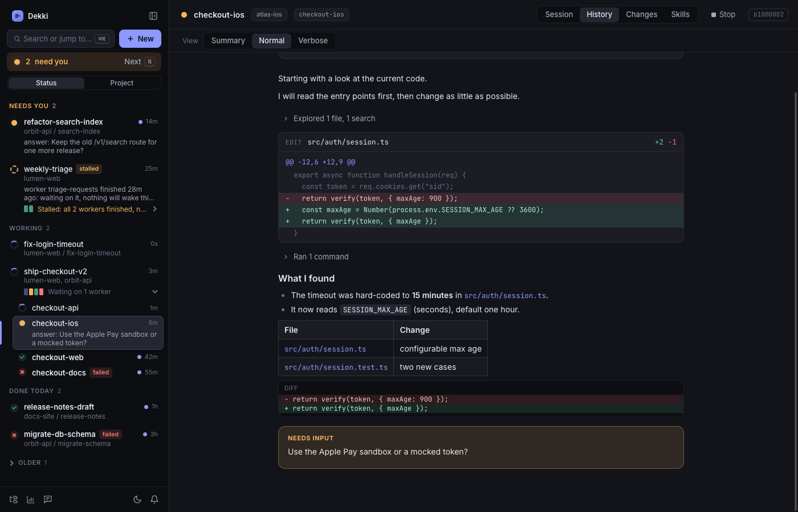
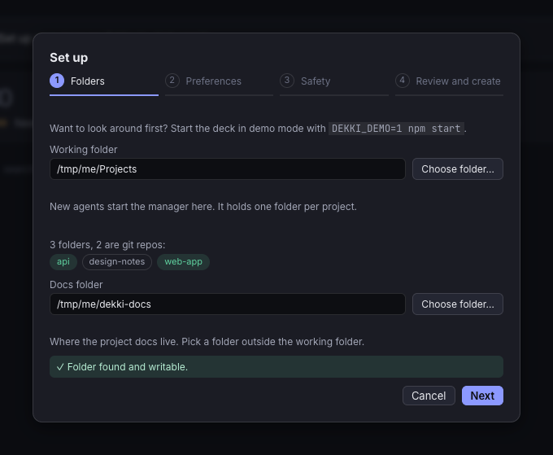
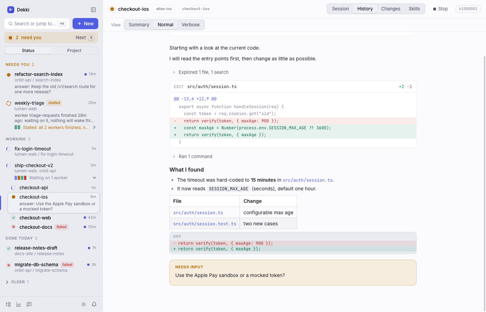
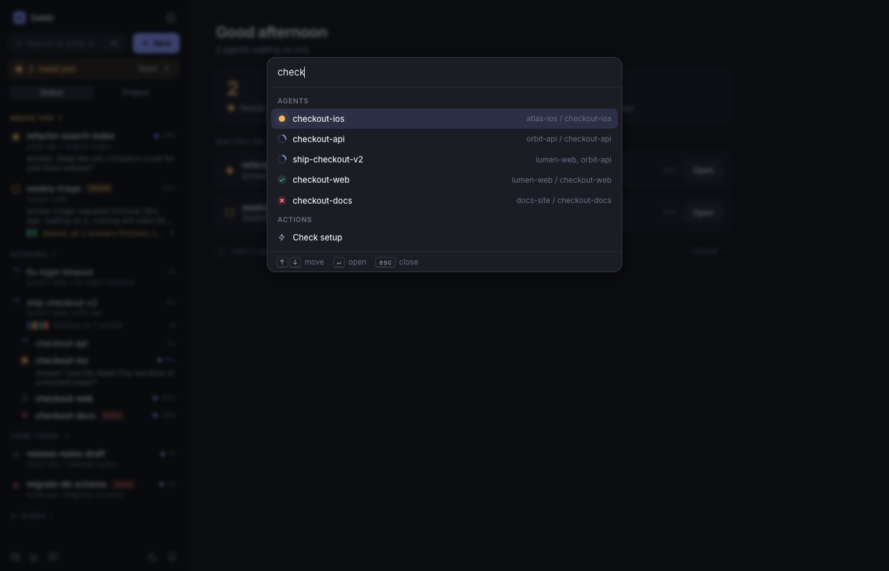
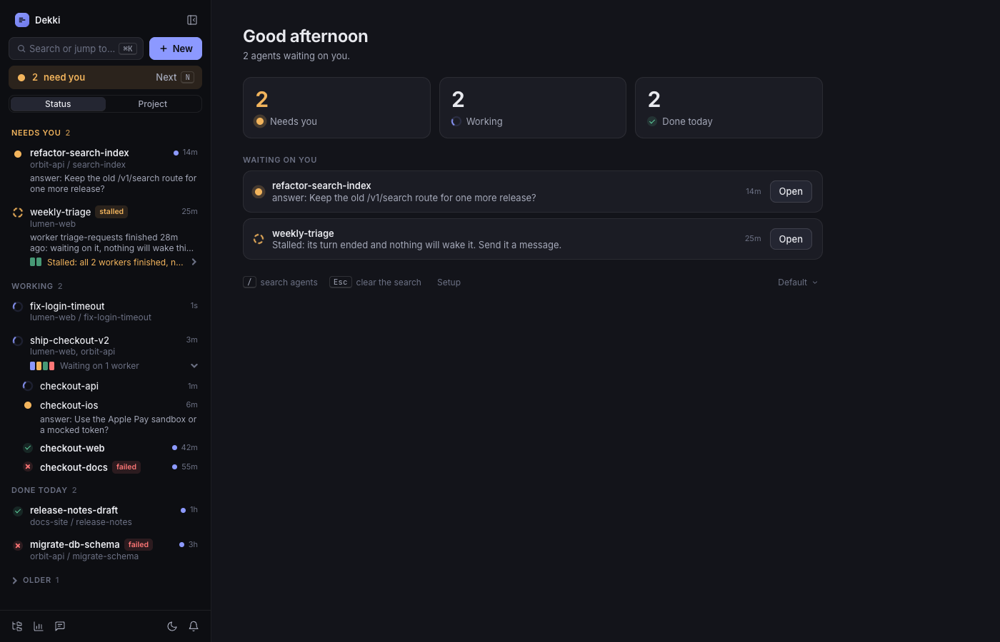

# Dekki

Dekki is a local web UI for Claude Code background agents: see every agent at a glance, read its full history, and jump into its live session.



Dekki runs on your machine, talks to the `claude` CLI, and shows what `claude agents` shows in a terminal, with a longer memory and a layout that makes it clear which agents need you.

## What it does

- **Agent list** grouped by what matters: needs you, working, done today, older. Each row has a status glyph, project and branch, and the question an agent is waiting on. Manager agents show a bar of their workers. A Status | Project switch regroups the list by project.
- **Session tab**: the real Claude Code terminal for the selected agent (it attaches with `claude attach`), so you can answer an agent without leaving the page.
- **History tab**: the full transcript read from Claude's session files, with no terminal scrollback limit. Consecutive tool calls fold into one line, edits show as diffs, and a closing `result:`, `needs input:` or `failed:` line gets its own card. Summary, Normal and Verbose views.
- **Command palette** (`Cmd+K`) to jump to any agent or run an action, plus keyboard navigation.
- **Mission-control home** with counts and the agents waiting on you.
- **Skill and tool stats** per agent and across all sessions.
- **Saved prompts**: markdown files in a folder, usable when you start a new agent.
- **Several Claude accounts**, each with its own config directory and working folder.
- **Notifications** when an agent needs you or finishes (macOS only, see below).
- Dark and light themes, with a System setting that follows the OS.

How it is built:

- It drives the `claude` CLI (`claude agents`, `claude attach`, `claude --bg`, `claude rm`). It does not reimplement Claude Code.
- It binds to `127.0.0.1` only and checks the Host and Origin headers on every request and WebSocket, so other websites in your browser cannot reach it.
- No database. The only state is one small JSON file (`~/.dekki/state.json`) holding pins, archived agents, custom names and settings.
- Few dependencies: `node-pty` and `ws` on the server; React, Vite and xterm.js for the page.

How I work with agents (a manager that delegates, isolated workers, evidence sized by the change, short docs) and how to adapt it: [docs/APPROACH.md](docs/APPROACH.md).

## Quick start

```
npm install
npm start
```

Open http://127.0.0.1:4317. Set `PORT` to use another port.

`npm start` builds the page into `dist/` the first time. After you change files under `web/`, run `npm run build` and reload the browser tab.

### Try it without any agents

Demo mode serves a fixed set of made-up agents, fake transcripts and a static terminal. It never calls `claude` and never reads or writes `~/.dekki` or `~/.claude`.

```
DEKKI_DEMO=1 PORT=4350 npm start
```

Start, stop, delete and upload are switched off in demo mode. Add `DEKKI_DEMO_ACCOUNTS=2` to show two made-up accounts and the account switcher.

## First-time setup

The first time you open Dekki, the home screen offers a **Set up** button (it is also in the command palette). A four-step wizard asks for your working folder (the folder that holds your projects), a docs folder (no default, you choose), a few preferences (reply style, autonomy, git habits, language) and what must stay safe. It writes a manager playbook and delegate scripts into the working folder. It never overwrites a file and never edits an existing `CLAUDE.md` unless you tick the box for it. It ends with a health check and tells you which folders to trust once. Background: [docs/APPROACH.md](docs/APPROACH.md).



## Multiple Claude accounts

Dekki shows one Claude account at a time. Each extra account has its own Claude config directory, so its login, agents and history stay separate. The deck does not log in for you.

1. Add the account (this creates the directory and records it in Dekki's state file):

   ```
   node scripts/add-account.mjs Second ~/.claude-second
   ```

2. Log in to it once, in a terminal, in a browser signed in to that account:

   ```
   CLAUDE_CONFIG_DIR=~/.claude-second claude auth login
   ```

3. Reload the deck. Once a second account exists, an account menu appears in the sidebar. With one account, nothing about accounts shows in the sidebar.

The home screen always has a small account button at the right end of the shortcut hints, and the command palette has an Accounts action. With one account they show these steps; with two or more they switch accounts and still offer the steps under a collapsed "Add another account" row, in case you want a third. Switching reloads the page. Claude asks you to trust each folder once per account, so the first agent you start in a folder with a new account may need that step.

## Requirements

- Node 22.12 or newer.
- The `claude` CLI on your `PATH`, signed in, with at least one workspace you have trusted by running `claude` in it once. `claude --bg` refuses untrusted workspaces and Dekki shows that error as it is.
- Optional: the manager template uses a writing-checker skill called unslop when it is installed in your Claude config directory; nothing breaks without it.
- macOS for the optional Mac app and for these features: notifications, the Choose folder button, Finder icons in the folder tree, and Show in Finder for saved prompts. I have only run Dekki on macOS. The server, the page and the terminal are plain Node and a browser and may work elsewhere, but that is untested.

## Keyboard shortcuts

Letter keys do nothing while a text field, a dialog or the terminal has focus. Press `?` in the app for the same list.

| Keys | Action |
|---|---|
| `Cmd+K` (`Ctrl+K` elsewhere) or `/` | Open the command palette: jump to an agent or run an action |
| `J` / `K` | Select the next / previous agent in the list |
| `N` | Select the next agent that needs you |
| `C` | New agent |
| `Cmd+1` to `Cmd+9` | Select the 1st to 9th pinned agent |
| `Cmd+B` | Show / hide the folder tree |
| `Cmd+Shift+S` | Show / hide skill usage |
| `Cmd+Shift+P` | Show / hide saved prompts |
| `?` | Show the shortcut sheet |
| `Esc` | Close the top-most dialog or the palette |

While the terminal has focus, `Ctrl` combinations stay with the terminal, so `Ctrl+K` does nothing there on other systems. `Cmd+K` works anywhere on a Mac.

## Screenshots

| | |
|---|---|
|  |  |
| Light theme, History tab | Command palette |
|  | |
| Home: counts and the agents waiting on you | |

All agents, projects and transcripts in the screenshots come from demo mode and are made up.

## Mac app (optional)

A small native shell around the same page. Build it from the repo (needs the Xcode command line tools):

```
mac/build.sh
open "mac/build/Dekki.app"
```

The app is a window with one web view on `http://127.0.0.1:4317`. If a deck is already running there it attaches to it and leaves it running when you quit. Otherwise it starts `node server/start.js` from this checkout and stops it on quit. It adds:

- a Dock badge and a menu-bar item with the number of agents that need you
- native notifications that open the agent when you click them
- start at login (approve it in System Settings if macOS asks)
- closing the window hides it, so the server and notifications keep running

The build is ad-hoc signed and gitignored. Move it to `/Applications` yourself. The app runs the checkout's `server/` and `dist/`, so after pulling changes run `npm run build`, and rebuild the app only if `mac/` changed.

The window uses a transparent title bar. That part has not been checked in a real window yet.

## Safety and notes

- **No authentication.** Anyone who can reach the port can read your transcripts and type into your agents. That is why it only listens on `127.0.0.1`. Do not put it behind a proxy or bind it to another interface.
- Dekki does not stop, delete or restart an agent on its own. Stop and Delete are buttons you press. Delete always asks first, and Stop asks when the agent looks busy. Agents that were not started from the deck go in an Other agents group and are not mixed into your list.
- Delete calls `claude rm`, which removes a clean worktree and keeps the branch. If the worktree has uncommitted changes, you get a warning, and discarding them needs an explicit checkbox. The deck never removes a worktree by any other route.
- Demo mode and the tests use throwaway state. They never touch real agents.
- Transcript parsing lives in one module (`server/transcript.js`). Claude's session file format is not documented and can change, so unknown record types are ignored.

## Development

```
npm run dev      # rebuild the page on change and restart the server
npm test         # node --test
```

Two test files use fixed ports (4398 and 4399) and fail with `EADDRINUSE` if something else holds them.

Environment variables:

| Variable | Effect |
|---|---|
| `PORT` | Port to listen on (default 4317) |
| `DEKKI_STATE` | Path of the state file (default `~/.dekki/state.json`) |
| `DEKKI_PROMPTS` | Folder for saved prompts (default `~/.dekki/prompts`, created when you save the first prompt; point it at any folder, for example a notes vault) |
| `DEKKI_NOTIFY=0` | No macOS notification banners |
| `DEKKI_DEMO=1` | Demo mode |

See [CONTRIBUTING.md](CONTRIBUTING.md) for setup, tests and the safety rules for tests, and [scripts/README.md](scripts/README.md) for the helper scripts.

## Status and notes

- Dekki is not affiliated with or endorsed by Anthropic. "Claude" and "Claude Code" are trademarks of Anthropic.
- It relies on the `claude` CLI and on the session-file (JSONL) format Claude Code writes, which is undocumented and can change. Unknown record types are ignored, but a new Claude Code version can still break parts of the History tab.
- Tested on macOS only.
- There is no authentication, by design: it is a single-user tool that listens on `127.0.0.1` only. See [SECURITY.md](SECURITY.md) for the threat model and how to report a vulnerability.

## Licence

MIT. See [LICENSE](LICENSE).
